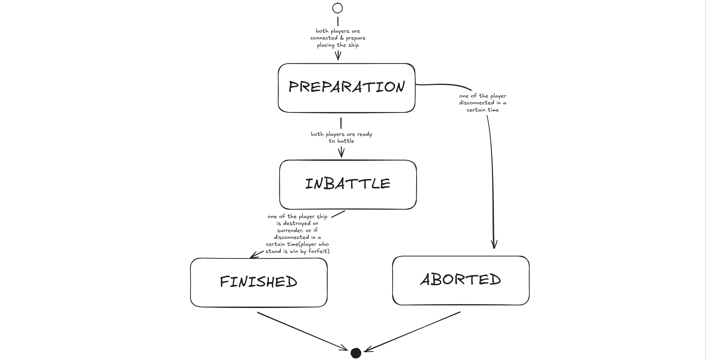

# BATTLESHIP PROJECT

## FSM Design

## Message Protocol

## Resources
- [FSM - Fundamental](https://gameprogrammingpatterns.com/state.html)
- [Lifecycle Events](https://docs.colyseus.io/room)
- [Handling Incomplate Games](https://docs.skillz.com/docs/aborts/)
- [Best Practice for Session-Based Games](https://openkruise.io/kruisegame/best-practices/session-based-game)
- [Async API SPECS](https://www.asyncapi.com/docs)
- [JSON Event-Based Convention for WebSockets](https://thoughtbot.com/blog/json-event-based-convention-websockets)
